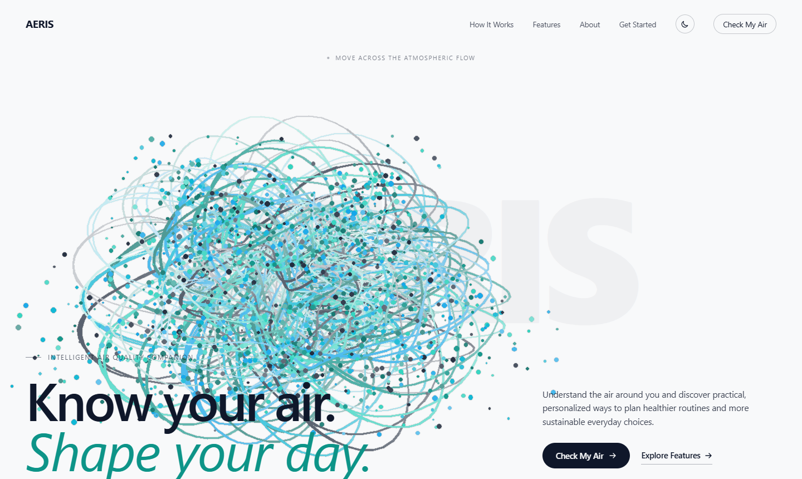
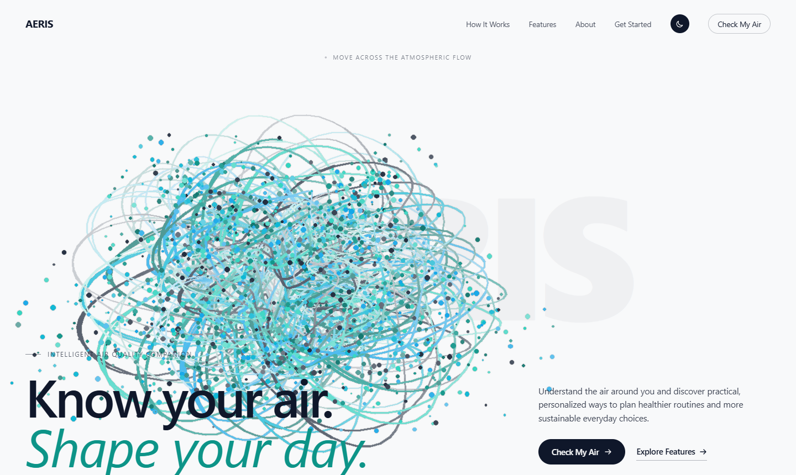
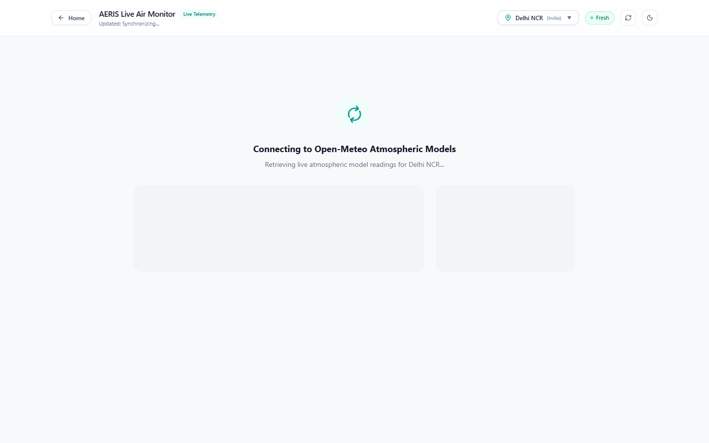
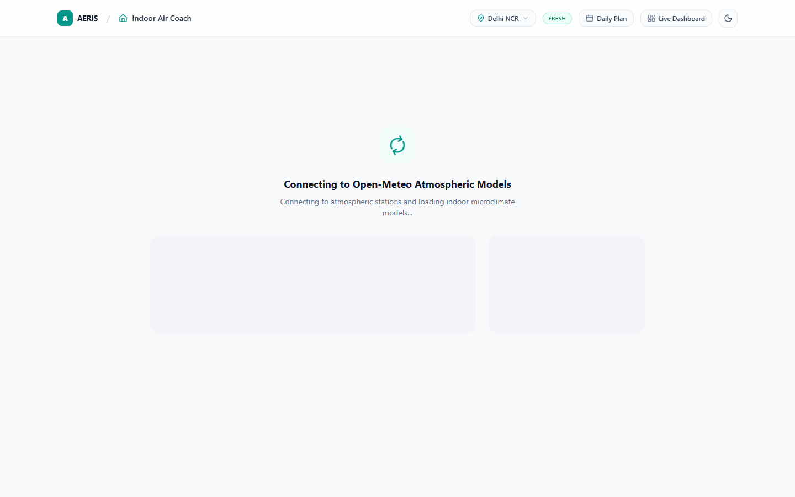
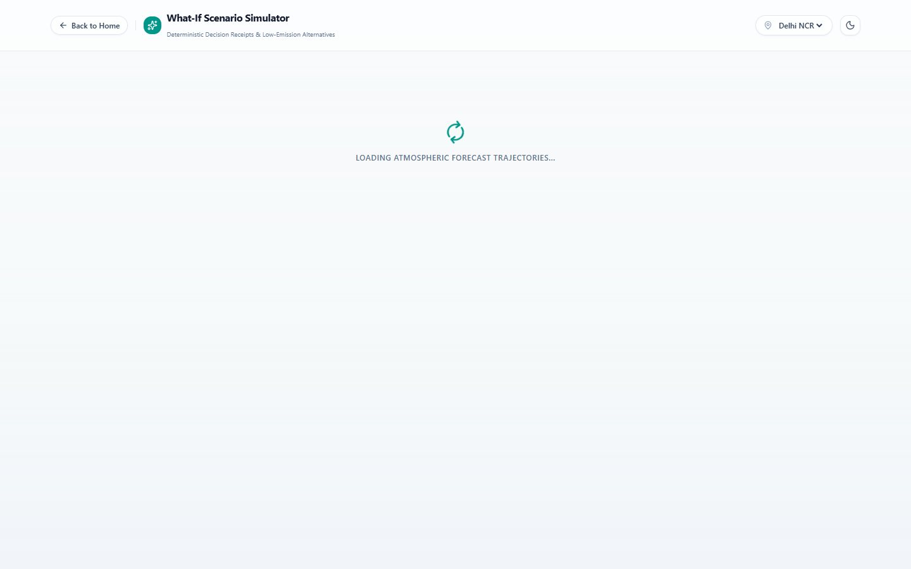
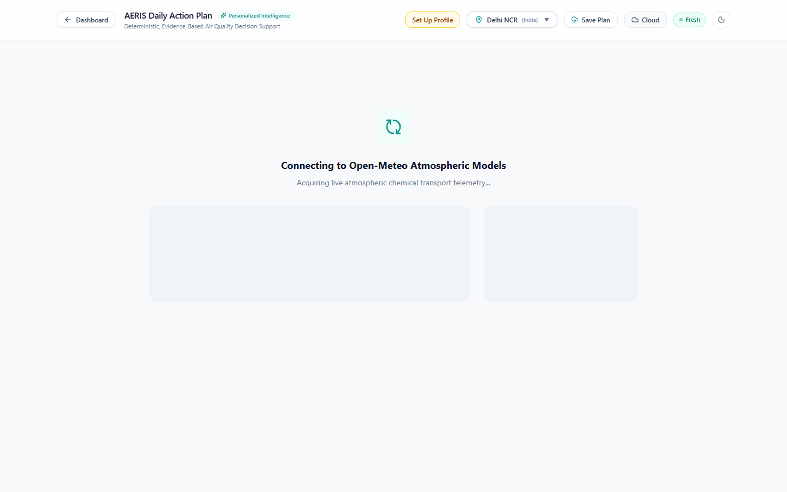
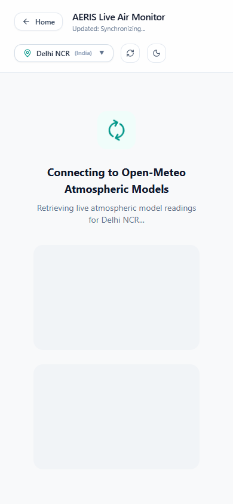
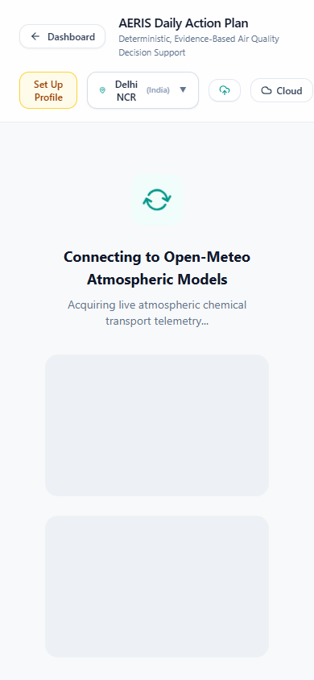
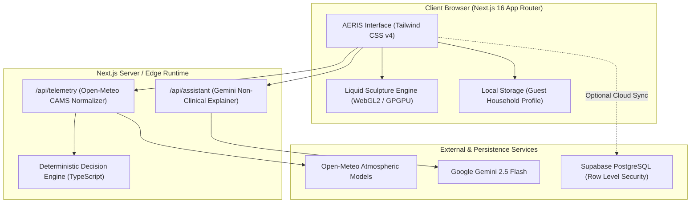

# AERIS — Urban Air Quality Decision Companion

> **Know your air. Shape your day.**

AERIS is an environmental intelligence platform that transforms modeled atmospheric data into contextual daily decisions. Instead of merely displaying raw particulate readings, AERIS evaluates personal vulnerability, household routines, and weather patterns to answer: **"What specific action should I take right now to protect my health?"**

---

## Product Showcase

### 1. Interactive Liquid Sculpture Hero (WebGL2)
Simulates fluid atmospheric particle transport with instanced GPGPU shaders and real-time pointer disturbance.

| Light Mode | Dark Mode |
| :---: | :---: |
|  |  |

---

### 2. Live Atmospheric Monitoring & Personalized Action Plan

| Live Air Monitor Dashboard | Personalized Daily Action Plan (AI Drawer) |
| :---: | :---: |
|  |  |
| Multi-index comparison (Indian CPCB, US EPA, European EAQI) with 24h hourly forecast. | Deterministic priority ranking with Plan B fallbacks and bilingual Gemini explanations. |

---

### 3. Indoor Hygiene & What-If Scenario Simulator

| Indoor Air Hygiene Coach | What-If Scenario Simulator |
| :---: | :---: |
|  |  |
| Dynamic indoor/outdoor ratio, CADR purifier sizing, and window protocols. | Commute mode optimization, departure timing, and low-emission alternatives. |

---

<details>
<summary><strong>View Additional Interface Captures (Decision Receipts, Cloud Auth, Mobile)</strong></summary>

### Cryptographic Decision Receipt & Cloud Sync

| Deterministic Decision Receipt | Cloud Persistence & Auth Interface |
| :---: | :---: |
|  |  |
| Immutable SHA-256 fingerprint, rule ID, and verification seal. | Optional Supabase authentication with Row Level Security. |

### Mobile Experience (390px Viewport)

| Mobile Telemetry Monitor | Mobile Daily Plan & AI Assistant |
| :---: | :---: |
|  |  |

</details>

---

## The Problem & Our Approach

Conventional air quality dashboards present retrospective concentration numbers ($\mu\text{g/m}^3$) that leave users guessing:
- Should I open my windows before cooking, or will that draw in street smog?
- Is an early-morning jog safe during an atmospheric inversion layer?
- Which air purifier CADR rating is actually required for my room dimensions?

AERIS resolves this with **three core engineering layers**:
1. **Multi-Standard Normalization**: Ingests Open-Meteo CAMS atmospheric forecasts and computes simultaneous Indian CPCB, US-EPA, and European EAQI indices with 24-hour rolling averages.
2. **Deterministic Decision Engine**: Evaluates rule-based lifestyle matrices (household sensitivity, exercise timing, commute type) with reproducible output IDs.
3. **Contextual AI Assistance**: Leverages Google Gemini to explain *why* an action was recommended in plain English or Hindi, strictly constrained by deterministic evidence citations.

---

## System Architecture



---

## Technology Stack

- **Framework**: Next.js 16.4.6 (App Router, Webpack bundling)
- **Frontend & Styling**: React 19.3.0, Tailwind CSS v4, Lucide Icons, Recharts
- **GPGPU Simulation**: WebGL2 with instanced floating-point textures and transform feedback
- **AI Integration**: Google Gen AI SDK (`@google/genai`) with structured guardrails
- **Database & Auth**: Supabase PostgreSQL (`@supabase/ssr`, `@supabase/supabase-js`) with strict Row Level Security (RLS)
- **Validation**: Zod 4.6.7 schema verification for all external and internal payloads
- **Testing**: Vitest 5.0.5 (unit & component tests), Playwright 1.50.0 (cross-browser E2E)
- **Language**: Strict TypeScript 5 with zero `any` tolerance

---

## Getting Started

### Prerequisites
- Node.js 20+ (Node.js 24 recommended)
- npm 10+

### Installation

1. **Clone the repository:**
   ```bash
   git clone https://github.com/YOUR_USERNAME/AERIS.git
   cd AERIS
   ```

2. **Install dependencies:**
   ```bash
   npm ci
   ```

3. **Configure Environment Variables:**
   ```bash
   cp .env.example .env.local
   ```
   Edit `.env.local` with your credentials:
   - `GEMINI_API_KEY`: Required for AI explanations ([Get a key](https://aistudio.google.com/app/apikey)).
   - `NEXT_PUBLIC_SUPABASE_URL`: Optional for cloud persistence.
   - `NEXT_PUBLIC_SUPABASE_PUBLISHABLE_KEY`: Optional for cloud persistence.

4. **Run Development Server:**
   ```bash
   npm run dev
   ```
   Open `http://localhost:3000` in your browser.

---

## Scientific Transparency & Disclaimers

- **Atmospheric Data**: Telemetry values are derived from Open-Meteo chemical transport models (CAMS Global). They represent continuous modeled estimates rather than certified stationary monitoring stations.
- **Indian National AQI**: Calculated using official Central Pollution Control Board (CPCB) sub-index breakpoints with 24-hour rolling averages where available.
- **Decision Receipts**: Scenario reduction metrics represent hypothetical differential models, not clinical exposure measurements.
- **Health Guidance**: AERIS provides non-clinical environmental decision support. It does not provide medical diagnoses or replace regulatory health advisories.

---

## Quality Gate & Verification

Run the comprehensive engineering quality gate:

```bash
# TypeScript type check
npm run typecheck

# Code formatting and linting
npm run lint

# Vitest unit and component test suite (199 tests across 24 suites)
npm test

# Production build compilation
npm run build

# Playwright end-to-end test suite
npm run test:e2e
```

---

## Security & Privacy

- **Guest-First Design**: All household profiles and preferences function completely in browser `localStorage`. No registration is required.
- **Row Level Security**: Supabase tables (`saved_plans`, `decision_receipts`, `scenario_history`) strictly enforce user-level RLS policies. Unauthenticated or cross-tenant access is rejected at the database level.
- **Secret Isolation**: Server-side credentials (Gemini API keys, service role keys) are never transmitted to client bundles.
