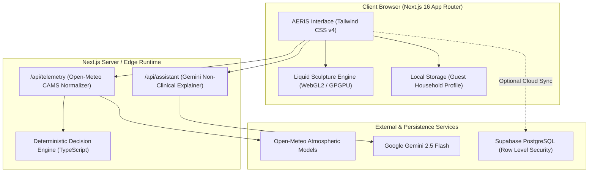

# AERIS — Urban Air Quality Decision Companion

> **Know your air. Shape your day.**

AERIS is an environmental decision-support platform that transforms modeled atmospheric data into contextual, actionable daily choices. Rather than presenting static concentration figures ($\mu\text{g/m}^3$) in isolation, AERIS evaluates personal vulnerability, household routines, commute preferences, and meteorological patterns to answer: **"What specific, verifiable action should I take right now to protect my health?"**

---

## Core Capabilities

### 1. Interactive Atmospheric Particle Simulation
- Real-time WebGL2 GPGPU particle engine simulating fluid aerodynamic transport.
- Interactive pointer and touch disturbance modeling atmospheric turbulence.
- Coordinated light and dark themes with zero-flicker client-state synchronization.

### 2. Live Atmospheric Monitoring & Multi-Standard Normalization
- Continuous atmospheric telemetry ingestion from Open-Meteo CAMS Global models.
- Multi-index evaluation: Indian National AQI (CPCB), US-EPA AQI, and European EAQI.
- Continuous 24-hour pollutant trends and hourly forecast horizons.

### 3. Personalized Daily Action Plans
- Deterministic lifestyle matrix ranking actions across commute, exercise, ventilation, and air filtration.
- Plan B contingency recommendations for deteriorating air conditions.
- Contextual AI explanations powered by Google Gemini, grounded strictly in official CPCB (2014) and WHO (2021) guidelines with bilingual English/Hindi support.

### 4. Indoor Air Hygiene Coach
- Physical infiltration model evaluating indoor vs. outdoor particulate equilibrium.
- HEPA purifier CADR sizing based on room volume, occupancy, and window sealing state.
- Safe natural ventilation scheduling based on outdoor pollutant forecast windows.

### 5. What-If Scenario Simulator & Decision Receipts
- Predictive simulation of commute alternatives, workout timing adjustments, and filtration interventions.
- Cryptographic Decision Receipts featuring SHA-256 fingerprints, verification timestamps, and reproducible rule citations.

---

## System Architecture



---

## Technology Stack

- **Framework**: Next.js 16.4.6 (App Router, Webpack bundling)
- **Frontend & Styling**: React 19.3.0, Tailwind CSS v4, Lucide Icons, Recharts
- **GPGPU Simulation**: WebGL2 with instanced floating-point textures and transform feedback
- **AI Integration**: Google Gen AI SDK (`@google/genai`) with structured guardrails
- **Database & Auth**: Supabase PostgreSQL (`@supabase/ssr`, `@supabase/supabase-js`) with strict Row Level Security (RLS)
- **Validation**: Zod 4.6.7 schema verification for all external and internal payloads
- **Testing**: Vitest 5.0.5 (unit & component tests), Playwright 1.50.0 (cross-browser E2E)
- **Language**: Strict TypeScript 5 with zero `any` tolerance

---

## Getting Started

### Prerequisites
- Node.js 20+ (Node.js 24 recommended)
- npm 10+

### Installation

1. **Clone the repository:**
   ```bash
   git clone https://github.com/Zyphron01/AERIS.git
   cd AERIS
   ```

2. **Install dependencies:**
   ```bash
   npm ci
   ```

3. **Configure Environment Variables:**
   ```bash
   cp .env.example .env.local
   ```
   Configure `.env.local` with your credentials:
   - `GEMINI_API_KEY`: Required for AI explanations ([Get a key](https://aistudio.google.com/app/apikey)).
   - `NEXT_PUBLIC_SUPABASE_URL`: Optional for cloud persistence.
   - `NEXT_PUBLIC_SUPABASE_PUBLISHABLE_KEY`: Optional for cloud persistence.

4. **Run Development Server:**
   ```bash
   npm run dev
   ```
   Open `http://localhost:3000` in your browser.

---

## Scientific Transparency & Disclaimers

- **Atmospheric Data**: Telemetry values are derived from Open-Meteo chemical transport models (CAMS Global). They represent continuous modeled estimates rather than certified stationary monitoring stations.
- **Indian National AQI**: Calculated using official Central Pollution Control Board (CPCB) sub-index breakpoints with 24-hour rolling averages where available.
- **Decision Receipts**: Scenario reduction metrics represent hypothetical differential models, not clinical exposure measurements.
- **Health Guidance**: AERIS provides non-clinical environmental decision support. It does not provide medical diagnoses or replace regulatory health advisories.

---

## Quality Gate & Verification

Run the comprehensive engineering quality gate:

```bash
# TypeScript type check
npm run typecheck

# Code formatting and linting
npm run lint

# Vitest unit and component test suite (206 tests across 25 suites)
npm test

# Production build compilation
npm run build

# Playwright end-to-end test suite
npm run test:e2e
```

---

## Security & Privacy

- **Guest-First Design**: All household profiles and preferences function completely in browser `localStorage`. No registration is required.
- **Row Level Security**: Supabase tables (`saved_plans`, `decision_receipts`, `scenario_history`) strictly enforce user-level RLS policies. Unauthenticated or cross-tenant access is rejected at the database level.
- **Secret Isolation**: Server-side credentials (Gemini API keys) are never transmitted to client bundles.
